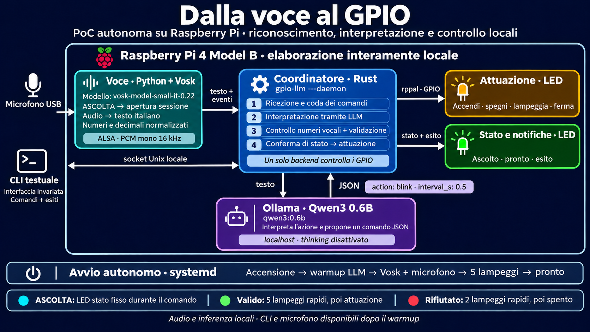

# raspi-gpio-llm

[](https://github.com/amplimax/raspi-gpio-llm/actions/workflows/ci.yml)

PoC autonoma su Raspberry Pi: una frase italiana diventa un comando verificato
per un LED. Funziona interamente in locale, con ingresso vocale attivato da
**ASCOLTA** e CLI testuale disponibile sullo stesso backend.



## Come funziona

```text
Microfono USB → ALSA → Python/Vosk → testo normalizzato ┐
                                                      ├→ backend Rust
CLI testuale → socket Unix locale ─────────────────────┘

Rust ↔ Ollama / Qwen3 0.6B → proposta JSON
     → vincoli numerici vocali → validazione → conferma → esecutore GPIO
```

L'LLM interpreta l'azione; il programma controlla numeri e policy. Il modello
non scrive codice, non esegue shell e non accede ai GPIO.

- **Vosk 0.3.45**, modello `vosk-model-small-it-0.22`: riconoscimento italiano locale.
- **Ollama**, modello `qwen3:0.6b`: interpretazione in JSON, thinking disattivato.
- **Rust + rppal**: coordinamento, validazione e attuazione.
- **systemd**: avvio autonomo, warmup verificato e riavvio su errore.

## Documentazione

- [Manuale tecnico HTML](docs/manuale-software.html): 20 capitoli, figure,
  glossario, ricerca e codice completo incorporato. Scarica il file e aprilo
  nel browser: funziona offline, senza server. Su GitHub il file viene mostrato
  come sorgente; usa **Download raw file** per consultarlo localmente.
- [Uso autonomo, configurazione e cablaggio](docs/ascolto-autonomo.md).
- [Ricostruzione da clone pulito e ambiente collaudato](docs/ripristino.md).
- [Diagnostica e modalità vocale manuale](voice/README.md).
- [Sviluppo, controlli e aggiornamento del repository](CONTRIBUTING.md).

## Hardware e comportamento

Verificato su Raspberry Pi 4 Model B, Debian 13 ARM64 e microfono USB ALSA.

| Uscita | BCM | Pin fisico | Funzione |
|---|---:|---:|---|
| LED attuatore | 17 | 11 | Accendi, spegni, lampeggia, ferma |
| LED stato | 23 | 16 | Pronto, ascolto, conferma/rifiuto |

Usa componenti e limitazione di corrente adatti alla logica GPIO a 3,3 V;
per i collegamenti completi consulta la guida al cablaggio. BCM23 è riservato
al programma e non è comandabile dall'utente.

Al boot il sistema verifica l'LLM, carica Vosk e apre il microfono; cinque
lampeggi sul LED di stato indicano il pronto. Poi:

1. Pronuncia **ASCOLTA** da sola e attendi il LED di stato fisso.
2. Pronuncia il comando. La cattura termina a fine frase, entro 12 s di default.
3. Il LED di stato si spegne durante l'elaborazione.
4. Un comando valido riceve **cinque lampeggi completi prima dell'attuazione**.
   Un comando rifiutato riceve due lampeggi e non modifica l'azione precedente.

Sono gestiti decimali e forme come «zero virgola venticinque», «un ottavo di
secondo», «un secondo» e «un secondo e mezzo». Il lampeggio cambia stato ogni
intervallo: 0,5 s significa 0,5 s acceso + 0,5 s spento.

## Installazione sul Raspberry

Prerequisiti: Linux ARM64, Rust/Cargo stabile, Python con venv/pip, `arecord`
(ALSA), Git e curl. L'utente del progetto deve poter accedere ad audio e GPIO.
Ollama deve essere già installato e gestito dal servizio `ollama.service`, con
API locale su `127.0.0.1:11434`. La preparazione richiede Internet; il normale
funzionamento successivo è locale.

```bash
ollama pull qwen3:0.6b
git clone https://github.com/amplimax/raspi-gpio-llm.git
cd raspi-gpio-llm
python3 scripts/prepara-raspberry.py
arecord -l
python3 install-autonomous-service.py --print-unit
python3 install-autonomous-service.py --install
```

Il dispositivo predefinito del collaudo è `plughw:CARD=Talk,DEV=0`. Se il tuo
microfono ha un nome differente, imposta `GPIO_VOICE_DEVICE` prima dell'installer.
L'installer si esegue come utente del progetto e chiede sudo nel terminale per
installare la unit. Non occorre mantenere aperto SSH per usare la voce.
La preparazione verifica il digest LLM, usa le dipendenze Python bloccate e
controlla il checksum del modello Vosk. Versioni e impronte sono registrate in
`docs/ambiente-collaudato.json`; i dettagli sono nella guida al ripristino.

## CLI e controllo del servizio

```bash
./target/release/gpio-llm
systemctl status gpio-llm-ready.service --no-pager
journalctl -u gpio-llm-ready.service -b -n 80 --no-pager
```

Nella CLI scrivi, per esempio, `Accendi il LED sul pin 17`. `esci` chiude solo
il client; il servizio e il microfono continuano a funzionare. La voce autonoma
usa controlli numerici aggiuntivi descritti nel manuale; la CLI conserva il suo
percorso testuale.

Il servizio imposta l'endpoint Ollama esplicitamente. Il default storico del
binario avviato direttamente è ancora `127.0.0.1:8080`; questo non cambia la
configurazione del servizio installato. I pin ammessi di default sono 17,27,22
e gli intervalli 0,1–60 s inclusi.

## Aggiornamento

```bash
git pull --ff-only
cargo test --locked
cargo build --release --locked
python3 -m unittest discover -s voice -p 'test_*.py' -v
python3 -m unittest discover -s tests -p 'test_*.py' -v
sudo systemctl restart gpio-llm-ready.service
```

Il riavvio interrompe le azioni attive e ripete il warmup. Serve anche dopo
modifiche Python, perché il worker non fa hot reload. Non riinstallare la unit
per ogni modifica ai sorgenti; usa l'installer quando cambia la configurazione
di installazione o su una nuova macchina.

## Struttura mantenuta

| Percorso | Contenuto |
|---|---|
| `src/` | Backend Rust, CLI, protocolli, validatore, esecutore e test |
| `voice/` | Worker Python, acquisizione/normalizzazione, test e diagnostica |
| `tests/` | Contratti dell'installer e della configurazione systemd |
| `install-autonomous-service.py` | Installer del servizio persistente |
| `scripts/service_support.py` | Helper attivi dell'installer |
| `scripts/prepara-raspberry.py` | Preparazione e test di un clone pulito ARM64 |
| `scripts/manuale/` | Testi, stile e interazioni del manuale |
| `scripts/genera-manuale.py` | Generatore HTML offline, solo libreria standard |
| `scripts/verifica-manuale.py` | Controllo browser opzionale con Playwright |
| `docs/` | Documentazione corrente, manuale, figure e prompt |
| `.github/` | CI e proposte di aggiornamento dipendenze |

Modelli, venv, binari, registrazioni, log, backup e appunti privati sono esclusi
dal repository. I test automatici non sostituiscono il collaudo con voce e LED
reali; l'esito software non è una misura elettrica dell'uscita.
